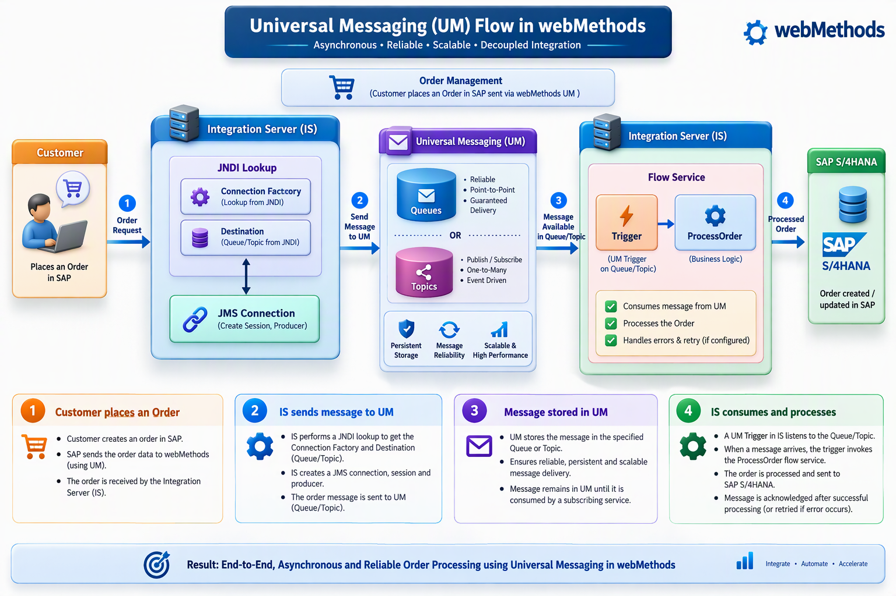
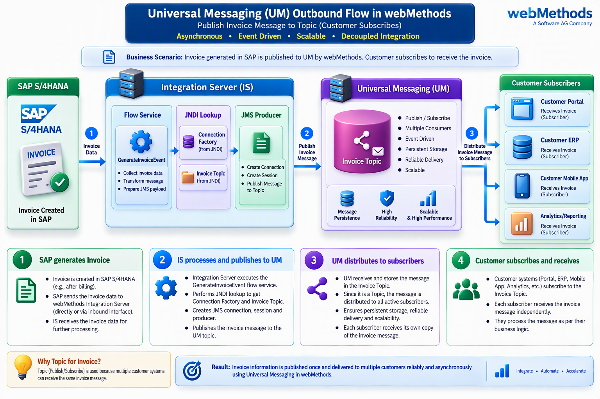

# webMethods Universal Messaging (UM) Architecture Patterns

This repository contains two common Universal Messaging integration patterns frequently discussed in webMethods interviews and real-world implementations.

---

# Inbound Processing Architecture

## Overview

This architecture demonstrates how a business transaction (Order) flows from a source system through webMethods Universal Messaging and ultimately reaches SAP S/4HANA for processing.

## Flow

1. Customer places an Order.
2. Integration Server performs JNDI Lookup.
3. Connection Factory and Destination are retrieved.
4. A JMS Producer publishes the message to Universal Messaging.
5. Universal Messaging persists and stores the message.
6. A Trigger listens on the destination.
7. Trigger invokes the Flow Service.
8. Flow Service executes business logic.
9. Data is sent to SAP S/4HANA.

## Why this Architecture?

This pattern provides:

- Asynchronous processing
- Loose coupling
- Reliable message delivery
- Retry capability
- Scalability
- Improved system availability

## Key Interview Points

### Why JNDI?

JNDI avoids hardcoding JMS resources and provides centralized configuration management.

### Role of Connection Factory

Connection Factory creates JMS connections between Integration Server and Universal Messaging.

### Role of Trigger

A Trigger listens for messages and automatically invokes Flow Services without polling.

### Queue vs Topic

Queue:
- Point-to-Point
- Single consumer

Topic:
- Publish-Subscribe
- Multiple subscribers

### Interview One-Liner

> Inbound architecture is typically used when external systems submit business transactions that must be reliably processed by SAP or downstream applications.

---

# Outbound Publishing Architecture

## Overview

This architecture demonstrates how SAP-generated business events are published through Universal Messaging and distributed to multiple consumers.

## Flow

1. SAP generates an Invoice.
2. Integration Server receives invoice data.
3. Flow Service prepares invoice event.
4. JNDI retrieves Connection Factory and Topic.
5. JMS Producer publishes message.
6. Universal Messaging stores the event.
7. Topic distributes the message to all subscribers.
8. Customer applications consume the invoice independently.

## Why this Architecture?

This pattern provides:

- Event-driven integration
- Publish/Subscribe messaging
- Multiple consumer support
- High scalability
- Reduced application dependencies

## Why Topic Instead of Queue?

Invoice information usually needs to be consumed by multiple applications.

Examples:

- Customer Portal
- Mobile Application
- ERP System
- Analytics Platform

Topic delivers a copy of the same event to each subscriber.

### Interview One-Liner

> If multiple systems require the same business event, Topic is preferred. If only one system should process the message, Queue is preferred.

---

# Important Universal Messaging Interview Concepts

| Component | Purpose |
|------------|------------|
| Universal Messaging | JMS Broker |
| Realm | Messaging Container |
| Queue | Point-to-Point Communication |
| Topic | Publish-Subscribe Communication |
| JNDI | Resource Lookup |
| Connection Factory | Creates JMS Connections |
| JMS Producer | Publishes Messages |
| JMS Consumer | Receives Messages |
| Trigger | Event Listener |
| Flow Service | Business Logic |
| Persistence | Prevents Message Loss |
| Durable Subscriber | Receives Missed Messages |
| DMQ | Stores Failed Messages |

---

# Quick Interview Summary

### Inbound Flow

Customer → Integration Server → Universal Messaging → Trigger → Flow Service → SAP

Used for:
- Order Processing
- Transaction Processing
- Request Submission

### Outbound Flow

SAP → Integration Server → Universal Messaging Topic → Multiple Subscribers

Used for:
- Invoice Distribution
- Notifications
- Business Events
- Event-Driven Architectures

### Golden Rule

- Queue = One Consumer
- Topic = Multiple Consumers

Understanding this distinction alone answers many Universal Messaging interview questions.
