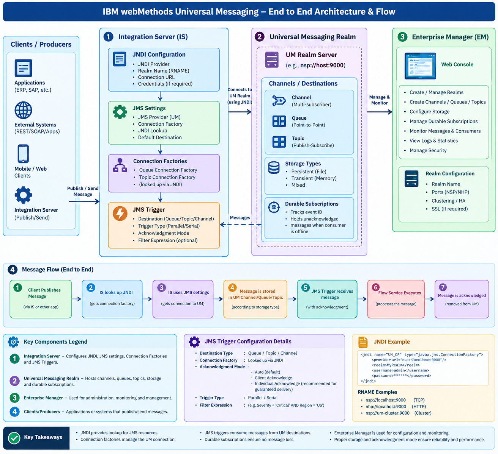

# IBM webMethods Universal Messaging – Complete End-to-End Flow

We'll understand Universal Messaging (UM) from absolute basics to a real-time project implementation, following the architecture diagram created earlier.

I'll use one practical example throughout:

**SAP sends a Purchase Order (PO) → Universal Messaging → webMethods Integration Server → Invoice Processing Application.**

By the end, you should understand not only how messages travel, but also why we create a Realm, JNDI configuration, Connection Factory, JMS Connection Alias, Queue/Topic, JMS Trigger and Flow Service.

One important clarification about the diagram: JNDI, JMS Settings and Connection Factory are not three consecutive message-processing stages. They are configuration components that work together to establish a JMS connection. We'll distinguish configuration order from actual message flow.



---

## 1. First, understand Universal Messaging using a post office example

Imagine a company sends hundreds of letters every day to different departments.

Instead of asking employees to deliver each letter directly, the company establishes a central post office.

### Post Office Analogy

| Post office concept | Universal Messaging concept | Explanation |
|---|---|---|
| Post office building | **Universal Messaging Realm** | Where letters arrive and are stored until they can be delivered. |
| Postal sorting boxes | **Queue / Topic / Channel** | Different arrangements for storing and distributing letters to recipients. |
| Address book | **JNDI** | A directory where applications look up connection details and messaging destinations. |
| Delivery transport service | **Connection Factory** | A predefined mechanism that creates the connection between the application and post office. |
| Postal worker | **JMS Trigger** | Receives an available letter and hands it to the correct department for processing. |

### How this relates to a real project

Suppose SAP generates purchase order `PO1001`.

SAP does not need to know whether the receiving application is available at that exact moment.

Instead:

1. SAP sends the purchase order to a publishing integration.
2. The publisher places the message in Universal Messaging.
3. UM stores and distributes the message according to its destination configuration.
4. A JMS Trigger in Integration Server receives the message.
5. The trigger executes a Flow Service.
6. The Flow Service processes the purchase order.
7. Successful processing is acknowledged according to the configured acknowledgement or transaction mechanism.

This separation is the main reason messaging platforms are useful.

---

# PART 1 — Configuration Flow (What we create first)

Before sending any messages, we must establish the messaging infrastructure.

The following is a logical setup order for learning. Some configuration steps can be performed independently or in a different order in an actual project.

## Step 1. Create and configure the Universal Messaging Realm

### What is a Realm?

A Realm is a running Universal Messaging server instance that accepts connections from applications and manages messaging resources.

Think of it as the main post office building.

Without a running Realm, applications cannot use the destinations hosted by that Realm.

For example, assume we install Universal Messaging on a server:

| Property | Example |
|---|---|
| Realm name | `UM_PROD_01` |
| Hostname | `umserver.company.com` |
| Native socket port | `9000` |
| Connection URL (RNAME) | `nsp://umserver.company.com:9000` |
| Environment | Production |

**RNAME** is the connection address that clients use to reach a Realm. It is not simply the display name of the Realm.

### What does `nsp://umserver.company.com:9000` mean?

```text
nsp://  +  umserver.company.com  +  :9000
Protocol       Hostname               Port
```

**Complete RNAME:** `nsp://umserver.company.com:9000`

Important connection protocols:

| Protocol | Purpose |
|---|---|
| `nsp://` | Native socket connection |
| `nsps://` | Secure native socket connection using TLS |
| `nhp://` | HTTP-based connection |
| `nhps://` | HTTPS-based connection |

These are connection transports, not different message types.

**Why is this configuration needed?**

Integration Server must know which UM server to contact, through which port and using which transport.

For production, you must also consider authentication, TLS certificates, network accessibility and high availability.

---

## Step 2. Understand Enterprise Manager

Now that our Realm exists, how do we administer it?

We use Universal Messaging administration tools, including Enterprise Manager in installations that provide it.

Enterprise Manager is primarily an administration and monitoring interface.

It is not a mandatory intermediate stop through which every business message travels.

Think of it as the post office manager's control room.

Through supported administration interfaces, administrators can inspect and manage Realm resources, such as:

- Channels and queues.
- Destination storage and capacity.
- Durable subscriptions.
- Connected clients and consumers.
- Access permissions.
- Server and messaging statistics.

### Example

Suppose you want to create a queue for purchase orders.

An administrator connects to the Realm using its configured address, then creates a destination named:

`SAP_PO_QUEUE`

Once created, this destination becomes available for suitably configured messaging clients.

**Important:** Enterprise Manager manages the UM server. Integration Server uses its own configuration to connect to that server. You do not need to keep Enterprise Manager open for messages to flow.

---

## Step 3. Create the messaging destination

This is one of the most important steps.

A destination is where the message is sent.

In our example, we want to transfer purchase orders from SAP to a processing service.

But first, we must decide whether to use a Queue or Topic.

### Queue vs Topic

**A. Queue — Point-to-point messaging**

```text
             SAP Publisher
                   |
                   v
             SAP_PO_QUEUE
       PO1001 · PO1002 · PO1003
              /         \
             v           v
        Consumer A   Consumer B
```

Competing consumers share the work. Each message is normally assigned to one consumer, subject to failure and redelivery.

**B. Topic — Publish/subscribe messaging**

```text
             SAP Publisher
                   |
                   v
             SAP_PO_TOPIC
                 PO1001
              /         \
             v           v
      Finance Subscriber  Audit Subscriber
             |                  |
           PO1001             PO1001
```

Each eligible subscription independently receives the published event.

### Which one should we choose?

Suppose SAP sends an invoice that only one worker should process. A queue with competing consumers is a suitable option.

But suppose the same invoice must be independently received by Finance, Analytics and Audit. A topic with separate subscriptions is more suitable.

For our continuing example, we'll choose:

`SAP_PO_QUEUE`

### Important destination properties

The exact property names and available choices depend on the installed UM version and destination type.

| Property | Meaning and why it matters |
|---|---|
| Destination name | Identifies where publishers send messages |
| Storage type | Determines how message data is stored |
| Max Events | Limits the number of events held, where supported |
| Max Bytes | Limits destination data capacity |
| Retention / TTL | Controls how long eligible messages can remain |
| Capacity policy | Determines behavior when configured limits are reached |
| Permissions | Controls who can publish, subscribe or administer |

For important purchase orders, we generally want an appropriately persistent configuration and a capacity policy that does not silently discard critical business messages.

A persistent destination alone does not guarantee successful end-to-end processing. Consumer configuration, acknowledgement, retention and error handling also matter.

---

## Step 4. Create the Connection Factory

Now our UM server and destination are available.

The next question is:

**How does a Java/JMS application establish a connection to Universal Messaging?**

This is where the Connection Factory comes into the picture.

### What is a Connection Factory?

A JMS Connection Factory is a configured object that a JMS application uses to create connections to a messaging provider.

Imagine a company has a transportation department.

Instead of each employee arranging their own vehicle, the company provides a central transport service with predefined connection details.

Similarly, applications use a Connection Factory rather than individually implementing all the connection setup.

Our example factory:

`UM_PO_CF`

It is configured to connect to the UM Realm.

### Important properties

| Property | Example / purpose |
|---|---|
| Connection Factory name | `UM_PO_CF` |
| Realm connection | UM Realm endpoint |
| Transport | Native socket or supported secure transport |
| Authentication | Credentials or configured authentication mechanism, where required |
| TLS settings | Certificates and trust configuration for secure connections |
| Reconnection/failover | Recovery behavior when connections are interrupted |

These are conceptual properties; the exact factory property names depend on the provider implementation and configuration method.

### Is Connection Factory the same as a JMS Connection?

No.

This is a common interview question.

- **Connection Factory:** The configured object used to create connections.
- **JMS Connection:** An actual connection created using that factory.

For example:

```text
Connection Factory: UM_PO_CF
             |
             | Creates
             v
       JMS Connection
             |
             v
     Universal Messaging
```

Creating a factory does not itself publish or consume a purchase order.

---

## Step 5. Understand JNDI and create the required configuration

This is usually where beginners get confused.

Let's understand it with a simple question.

We created a Connection Factory named `UM_PO_CF`.

But how will Integration Server find that object?

One common approach is JNDI.

### What is JNDI?

JNDI stands for **Java Naming and Directory Interface**.

It provides a standard Java mechanism to look up named resources.

Think of your mobile contact list.

You save:

```text
Name: Office
Phone: 9876543210
```

When you want to call your office, you search for the contact name instead of remembering the phone number.

Similarly, JNDI allows an application to look up configured resources using their registered names.

For example:

```text
JNDI Lookup
    |
    | Search: UM_PO_CF
    v
Connection Factory Object
```

JNDI is not the messaging server, the queue or the message transport.

### Important JNDI properties

| Property | Explanation |
|---|---|
| Initial Context Factory | Java class that creates the provider-specific JNDI context |
| Provider URL | Address used to access the naming provider |
| Security Principal | Authentication identity, if required |
| Security Credentials | Authentication secret, if required |
| Lookup Name | Registered name of the resource to retrieve |

For Universal Messaging, the exact provider class, lookup names and URL format must match the installed JMS client libraries and your JNDI configuration.

### Two important resources

In a typical JMS setup, the application may look up:

1. Connection Factory — `UM_PO_CF`
2. Destination — `SAP_PO_QUEUE`

These are two different objects.

The Connection Factory establishes the connection.

The destination identifies where the messages should be sent or consumed.

### How JNDI works in our example

```text
Integration Server
       |
       | JNDI Lookup
       v
Naming Provider
       |
       | Returns:
       |
       +---- UM_PO_CF
       |
       +---- SAP_PO_QUEUE
```

Once Integration Server obtains these resources, it can use the JMS API to interact with UM.

**Important distinction:** JNDI is a resource lookup mechanism. It does not store the actual purchase orders, and it is not required to be queried separately for every message.

---

## Step 6. Configure JMS Settings in Integration Server

Until now, we have prepared the UM side and explained the connection resources.

Now we move into IBM webMethods Integration Server.

We need to configure IS so that it can use the UM JMS provider.

The key configuration is the **JMS Connection Alias**.

### What is a JMS Connection Alias?

It is a named configuration in Integration Server that identifies the JMS provider and the resources needed to establish JMS connections.

Suppose we create:

`UM_PO_JMS_ALIAS`

The alias connects our IS JMS services and triggers with the required JMS provider configuration.

### Conceptual configuration

| Property | Example |
|---|---|
| Alias Name | `UM_PO_JMS_ALIAS` |
| JMS Provider | Universal Messaging |
| JNDI Provider Alias | Configured UM JNDI provider |
| Connection Factory Lookup Name | `UM_PO_CF` |
| Client ID | Configured where required, especially for relevant durable subscription arrangements |
| Enabled | Yes |

Depending on the IS release, additional options may include connection pooling, transaction support and other provider-specific settings.

### How are JNDI and JMS Alias related?

```text
        JMS Connection Alias
          UM_PO_JMS_ALIAS
                 |
                 v
           JNDI Provider
        Looks up UM_PO_CF
                 |
                 v
         Connection Factory
       Creates the JMS connection
                 |
                 v
              UM Realm
 nsp://umserver.company.com:9000
```

Think of it this way:

- JNDI tells Integration Server where to find the connection resources.
- Connection Factory creates the JMS connection.
- JMS Connection Alias makes that configuration available to IS messaging components.
- UM Realm is the actual messaging server.

**One important note:** webMethods also supports native webMethods Messaging connections to UM. Those use webMethods Messaging configuration and webMethods Messaging Triggers rather than necessarily using this JNDI/JMS setup. We are following the JMS-specific architecture requested in your diagram.

---

## Step 7. Create the JMS Trigger

Now we have established the connection between Integration Server and UM.

But who receives the incoming messages automatically?

That is the responsibility of a JMS Trigger.

### What is a JMS Trigger?

A JMS Trigger is an Integration Server component that listens for messages on a configured JMS destination and invokes processing services when eligible messages arrive.

Our example:

`POProcessingTrigger`

The trigger listens to:

`SAP_PO_QUEUE`

When a purchase order arrives, it invokes the appropriate Flow Service.

### Important JMS Trigger properties

The names and supported options can vary between IS versions, but these are the major concepts to understand.

| Property | Example | Why we configure it |
|---|---|---|
| Trigger Name | `POProcessingTrigger` | Identifies the trigger |
| JMS Connection Alias | `UM_PO_JMS_ALIAS` | Selects the JMS provider connection |
| Destination Name | `SAP_PO_QUEUE` | Identifies the source of messages |
| Destination Type | Queue | Determines consumption semantics |
| Message Selector | Optional | Filters eligible JMS messages |
| Processing Mode | Serial / Concurrent, where supported | Controls processing concurrency |
| Acknowledgement | Supported mode for the selected trigger configuration | Controls successful delivery acknowledgement |
| Transaction Handling | Local or supported transactional configuration | Coordinates processing and message acknowledgement |
| Retry/Error Handling | Configured failure policy | Handles processing failures |
| Enabled State | Enabled | Allows the trigger to consume messages |

### What is a Message Selector?

Suppose the queue contains messages from different regions.

Each message includes a JMS property:

`Region = 'US'`

We want this particular trigger to receive only US-region messages.

A supported JMS selector could be:

```sql
Region = 'US'
```

The selector operates on eligible JMS message properties or headers, not automatically on arbitrary fields buried inside a JSON or XML payload.

### Serial vs concurrent processing

Assume three purchase orders arrive:

```text
PO1001
PO1002
PO1003
```

In serial processing:

```text
PO1001 → Complete
PO1002 → Complete
PO1003 → Complete
```

In concurrent processing, separate executions may overlap:

```text
Thread 1 → PO1001
Thread 2 → PO1002
Thread 3 → PO1003
```

Concurrent processing can improve throughput, but completion order is not necessarily the same as arrival order.

For messages with strict business sequencing requirements, choose your processing design carefully.

---

## Step 8. Create the Flow Service

The trigger itself is not where we implement the entire business integration.

The trigger invokes a service that contains our processing logic.

Let's create:

`company.sap.po:processPurchaseOrder`

Suppose SAP sends:

```json
{
  "PO_NUMBER": "PO1001",
  "CUSTOMER": "ABC",
  "MATERIAL": "MAT100",
  "QUANTITY": 10
}
```

Our Flow Service performs the following operations:

```text
Receive JMS message
        |
        v
Extract and validate purchase order
        |
        v
Check whether PO1001 was already processed
        |
        v
Perform required field mapping
        |
        v
Invoke target application
        |
        v
Handle target response
        |
        v
Complete processing successfully
```

The JMS Trigger invokes this service after receiving an eligible message.

Once the service completes, the configured acknowledgement/transaction handling determines how the messaging delivery is finalized.

This brings us to the actual runtime message flow.

---

# PART 2 — Actual Runtime Flow

We have now configured everything required for our example.

Our architecture contains:

| Component | Configured object |
|---|---|
| UM Realm | `UM_PROD_01` |
| Queue | `SAP_PO_QUEUE` |
| Connection Factory | `UM_PO_CF` |
| JMS Connection Alias | `UM_PO_JMS_ALIAS` |
| JMS Trigger | `POProcessingTrigger` |
| Flow Service | `company.sap.po:processPurchaseOrder` |

Now imagine SAP creates a purchase order at 10:00 AM.

What exactly happens?

## Step 9. SAP publishes a message

SAP creates purchase order `PO1001`.

Assume SAP invokes an Integration Server REST API:

`POST /purchaseorders`

The API receives the purchase order and invokes a publisher Flow Service.

The publisher service uses the configured JMS connection to send a JMS message to `SAP_PO_QUEUE`.

In webMethods, a JMS publishing implementation can use the relevant `pub.jms` services, such as `pub.jms:send`, subject to the installed version and service configuration.

### What happens internally?

The publisher:

1. Selects the JMS Connection Alias.
2. Obtains the required JMS connection resources.
3. Identifies the target destination.
4. Constructs the JMS message.
5. Sends the message to the destination.

The actual JMS connection may already be established and reusable. These configuration lookups are not necessarily repeated for every purchase order.

### What is inside a JMS message?

A JMS message is more than just its business payload.

**Example JMS Message**

```text
1. JMS Headers

JMSMessageID: ID:123456
JMSDestination: SAP_PO_QUEUE
JMSDeliveryMode: PERSISTENT
JMSPriority: 4
JMSExpiration: 0

2. Custom JMS Properties

Region: US
DocumentType: PurchaseOrder
SourceSystem: SAP

3. Message Body
```

```json
{
  "PO_NUMBER": "PO1001",
  "CUSTOMER": "ABC",
  "QUANTITY": 10
}
```

Important message properties:

| Property | Purpose |
|---|---|
| JMSMessageID | Provider-assigned message identifier |
| JMSCorrelationID | Relates messages belonging to the same business interaction |
| JMSDeliveryMode | Persistent or nonpersistent delivery request |
| JMSPriority | Delivery priority, subject to provider behavior |
| JMSExpiration | Message expiry timestamp; zero conventionally means no expiration |
| JMSRedelivered | Indicates the provider believes the message may have been delivered previously |

Do not confuse `JMSMessageID` with the purchase order number. One identifies a messaging operation; the other identifies a business transaction.

---

## Step 10. Universal Messaging receives and stores the message

UM receives the message from the JMS publisher.

It identifies the target destination:

`SAP_PO_QUEUE`

The message is accepted and handled according to the destination's storage, capacity, security and delivery configuration.

Our example assumes a suitably persistent setup.

At this point, the purchase order has reached the messaging infrastructure, but that does not mean the receiving business application has successfully processed it.

This distinction is extremely important in production.

### What if the consumer is offline?

Suppose Integration Server is unavailable for 20 minutes.

SAP continues publishing messages.

If the queue and its persistence, retention and capacity policies are configured appropriately, pending messages can remain available for subsequent consumption.

For example:

| Time | Event |
|---|---|
| 10:00 | IS consumer becomes unavailable |
| 10:01 | PO1001 arrives |
| 10:02 | PO1002 arrives |
| 10:03 | PO1003 arrives |
| 10:20 | IS consumer reconnects |
| After reconnection | Pending messages become available for processing |

This is one of the major benefits of asynchronous messaging.

However, persistence is not unlimited storage. Capacity and retention policies must be designed for the expected outage duration and message volume.

---

## Step 11. JMS Trigger receives the message

Our trigger:

`POProcessingTrigger`

is configured to consume from:

`SAP_PO_QUEUE`

When it has an active connection and is enabled, it can receive eligible messages from that destination.

The trigger checks its applicable message-selection and processing configuration.

It then invokes:

`company.sap.po:processPurchaseOrder`

The trigger is effectively the bridge between the JMS messaging system and the Integration Server business logic.

### What about durable subscriptions?

This is another frequently misunderstood topic.

A durable subscription is especially important in JMS Topic-based messaging.

Consider:

```text
                  SAP_PO_TOPIC
                       |
             +---------+---------+
             |                   |
       Finance Subscriber   Audit Subscriber
             |                   |
       Durable State        Durable State
```

Each durable subscription maintains its own consumption interest/state, allowing eligible messages to remain available while that subscription's consumer is offline, subject to the provider's policies.

For our queue-based example, you do not ordinarily create a separate JMS durable topic subscription. The queue itself provides competing-consumer messaging semantics.

Native UM durable subscriptions and JMS durable topic subscriptions are related concepts, but their configuration and behavior should not be treated as interchangeable.

---

## Step 12. Flow Service processes the purchase order

The trigger receives `PO1001` and executes our Flow Service.

Imagine the target application expects the following structure:

```json
{
  "orderId": "PO1001",
  "customerCode": "ABC",
  "orderedQuantity": 10
}
```

The Flow Service maps the SAP structure into the target structure.

It then invokes the target application.

Two outcomes are possible.

### Scenario A: Successful processing

```text
JMS Trigger
    |
    v
Flow Service
    |
    v
Validate PO1001
    |
    v
Map Purchase Order
    |
    v
Target Application
    |
    v
Successful Response
    |
    v
Service Completes
```

The JMS delivery can then be acknowledged or committed according to the trigger's configured handling.

### Scenario B: Failed processing

Suppose the target application is unavailable.

```text
JMS Trigger
    |
    v
Flow Service
    |
    v
Target API Call
    |
    v
HTTP 503 / Connection Failure
    |
    v
Error Handling
    |
    v
Configured Retry / Recovery
```

The appropriate action depends on whether the failure is temporary, permanent or potentially ambiguous.

For example, a timeout does not necessarily mean the target failed to create the purchase order. It might have processed the request but failed to return a response.

That is why idempotency is important.

---

## Step 13. Understand acknowledgements and redelivery

This is one of the most important concepts for a senior webMethods developer.

### What is acknowledgement?

An acknowledgement tells the messaging provider that the consumer has accepted responsibility for the message according to the configured delivery semantics.

Consider the post office example.

A delivery worker receives a registered letter.

The delivery is not considered complete merely because the worker picked up the letter. Completion must be recorded according to the delivery process.

Messaging acknowledgements work on a similar principle.

### Common JMS acknowledgement concepts

| Mode | Meaning |
|---|---|
| AUTO_ACKNOWLEDGE | The JMS session handles acknowledgement automatically according to its delivery semantics |
| CLIENT_ACKNOWLEDGE | The client explicitly acknowledges received messages; standard JMS acknowledgement can cover multiple messages in a session |
| DUPS_OK_ACKNOWLEDGE | Allows lazy acknowledgement and potentially more duplicate deliveries |
| Transacted session | Message acknowledgement is coordinated through session commit or rollback |

Exact options exposed by an IS JMS Trigger depend on its configuration and version. Do not assume every trigger offers every raw JMS session mode.

### What if processing fails?

Consider this sequence:

1. IS receives `PO1001`.
2. The Flow Service sends it to the target database.
3. The database successfully commits.
4. IS crashes before the JMS delivery is finalized.
5. The messaging provider subsequently redelivers the message.

The target database might now receive `PO1001` twice.

This is why persistent messaging and acknowledgements alone do not guarantee exactly-once business processing.

### How do we prevent duplicate business transactions?

Implement idempotency.

Before creating a purchase order, check whether its business identifier has already been successfully processed.

```text
Receive PO1001
      |
      v
Does PO1001 already exist?
      |
   +--+--+
   |     |
  YES    NO
   |     |
   v     v
Avoid   Process
repeat  purchase order
```

In production, the check and write should be designed safely for concurrency, often using database uniqueness constraints or an appropriate transactional mechanism.

---

# PART 3 — Important Supporting Concepts

## 14. What happens when a message repeatedly fails?

Suppose SAP publishes an invoice containing an invalid customer code.

The trigger receives it, but validation fails every time.

Simply retrying indefinitely will not correct the customer code.

A better design separates temporary failures from permanent failures.

```text
JMS Trigger receives message
             |
             v
      Processing fails
             |
        +----+----+
        |         |
        v         v
 Temporary      Permanent
   error          error
        |         |
        v         v
Controlled    Quarantine
  retry       for correction
                  |
                  v
           Dead Letter Queue
             SAP_PO_DLQ
```

A DLQ is not automatically created for every JMS trigger. Its availability and routing behavior depend on the provider, Integration Server configuration and application design.

If you implement custom DLQ handling, ensure the original message is not acknowledged and lost before the failed-message handoff is safely completed.

---

## 15. What is Enterprise Manager doing during runtime?

Enterprise Manager remains an administrative and monitoring tool.

It does not execute the purchase order mapping or sit between the trigger and Flow Service.

An administrator can use supported monitoring tools to investigate:

| Metric | Why it matters |
|---|---|
| Realm status | Is the messaging server healthy? |
| Connected clients | Is Integration Server connected? |
| Destination event count | Are messages accumulating? |
| Consumer/subscription state | Is the expected consumer active? |
| Message throughput | How quickly are messages arriving and being consumed? |
| Storage utilization | Is the destination approaching capacity? |
| Memory usage | Is the server under memory pressure? |

### Example production issue

SAP publishes 1,000 messages per minute, but the receiving application processes only 600.

The backlog grows by approximately 400 messages per minute.

After one hour, the additional backlog is approximately 24,000 messages, assuming constant rates.

This is called a slow-consumer or backpressure situation.

Monitoring allows the team to identify it before destination capacity or downstream processing becomes a serious problem.

---

# PART 4 — Putting Everything Together

## 16. Complete configuration order

The following table is the most useful reference when setting up a JMS-based UM integration for the first time.

| Order | Configuration | Where | Purpose |
|---:|---|---|---|
| 1 | UM Realm | UM Server | Hosts the messaging infrastructure |
| 2 | Realm interface / RNAME | UM Server | Provides the connection endpoint |
| 3 | Queue / Topic | UM Administration | Defines the message destination |
| 4 | Storage and security | UM Administration | Controls retention, capacity and access |
| 5 | Connection Factory | UM JMS configuration | Creates JMS connections |
| 6 | JNDI configuration | Naming provider / IS | Makes JMS resources discoverable |
| 7 | JMS Connection Alias | IS Administrator | Connects IS to the JMS provider |
| 8 | JMS Trigger | Designer | Consumes incoming JMS messages |
| 9 | Flow Service | Designer | Executes business processing |
| 10 | Publisher Service | Designer | Sends messages to UM |
| 11 | Monitoring and recovery | UM / IS | Supports production operations |

The Connection Factory, JNDI and JMS Alias configurations must reference one another correctly. Their setup can be coordinated rather than being strictly sequential.

## 17. The actual end-to-end runtime flow

This is the sequence to remember for interviews.

```text
1. SAP Application
   Creates PO1001
          |
          v
2. Publisher Flow Service
   Constructs the JMS message
          |
          v
3. JMS Connection Alias
   Provides access to the configured JMS connection
          |
          v
4. JNDI / Connection Factory
   Resolves resources and establishes connections as needed
          |
          v
5. Universal Messaging Realm
   Receives the published message
          |
          v
6. SAP_PO_QUEUE
   Holds the message according to its storage and delivery policies
          |
          v
7. JMS Trigger
   Consumes an eligible message
          |
          v
8. Processing Flow Service
   Validates, maps and processes PO1001
          |
          v
9. Target Application
   Receives the business transaction
          |
          v
10. Acknowledgement / Commit
    Finalizes the JMS delivery according to configuration
```

Remember that step 4 represents connection setup or reuse, not a mandatory lookup performed separately for every message. Similarly, acknowledgement timing depends on the configured transaction and trigger behavior.

## 18. Five important interview questions

### Q1. Can we use UM without JNDI?

Yes. JNDI is a resource lookup mechanism. Native UM clients and some JMS configurations can establish connections without requiring the same JNDI lookup arrangement.

### Q2. Are Connection Factory and JMS Connection Alias the same?

No. A Connection Factory is a JMS object used to create connections. A JMS Connection Alias is an Integration Server configuration that makes the JMS provider connection available to IS components.

### Q3. Does Enterprise Manager receive and forward every message?

No. Enterprise Manager is an administration and monitoring tool. Actual messaging occurs between clients and the UM server.

### Q4. What is the difference between a JMS Trigger and a webMethods Messaging Trigger?

A JMS Trigger uses the JMS provider configuration and JMS destinations. A webMethods Messaging Trigger uses webMethods Messaging infrastructure and publishable document types. They are different integration mechanisms.

### Q5. Does persistent messaging guarantee exactly-once processing?

No. Persistence improves recoverability, but a failure between business processing and acknowledgement can cause redelivery. Idempotency and appropriate transaction handling are still necessary.

### Final concept to remember

Universal Messaging is not simply about sending a message from one application to another.

It separates the sender and receiver, manages message delivery, and supports asynchronous integration.

In our architecture:

**JNDI finds resources → Connection Factory creates connections → JMS Alias makes the connection available to IS → UM handles messages → JMS Trigger consumes them → Flow Service performs business processing.**

Enterprise Manager administers and monitors the UM environment independently of that message-processing path.

Once this distinction is clear, understanding JMS configurations, queues, topics, durable subscriptions, acknowledgement and production troubleshooting becomes considerably easier.
